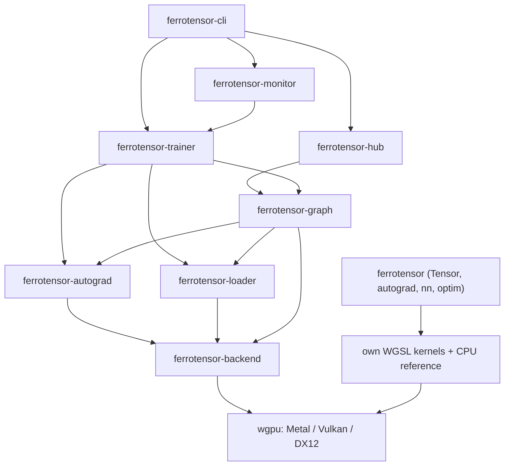

<h1 align="center">Ferrotensor</h1>

<p align="center"><strong>A pure-Rust GPU ML framework: no CUDA, no Python, no C++ toolchain.</strong></p>

<p align="center">
  <a href="https://github.com/puranikyashaswin/ferrotensor/actions/workflows/ci.yml"></a>
  <a href="https://crates.io/crates/ferrotensor"></a>
  <a href="https://docs.rs/ferrotensor"></a>
  
  
  
  
</p>

Ferrotensor (Ferro Tensor) runs tensors, autograd and LoRA fine-tuning of
small language models on the GPU using [wgpu](https://wgpu.rs) and
hand-written WGSL compute kernels, which run through Vulkan, Metal or DX12.
It has been tested on an NVIDIA A10G (24 GB) through Vulkan, an Apple M2
(8 GB) through Metal, and software Vulkan (Mesa lavapipe) in CI. The GPU test
suite also runs in CI through Metal on GitHub's Apple silicon runners (a
virtualised GPU) and through DX12 on WARP, Microsoft's software adapter;
neither is a real-hardware result. Other GPUs are untested, and
[reports are welcome](docs/testing-on-your-gpu.md). There is no CUDA, cuDNN or libtorch to install and no Python at runtime:
`cargo build` is the whole toolchain. The same tensor API also runs on a CPU
device, which the test suite uses as the reference for the GPU. It is built
for anyone who wants to read, and change, every layer from the API down to
the shader. It is young: pre-1.0, one maintainer, small-scale by design.
Arithmetic and trainable parameters are f32; the CLI stores frozen LoRA base
weights as f16 by default to save memory (`--f32-weights` keeps them f32).

- [The commands](#the-commands) · [Install](#install) · [Quickstart](#quickstart) · [Python](#python) · [Features](#feature-matrix) · [Architecture](#architecture) · [Compared with candle, burn and tch](#compared-with-candle-burn-and-tch) · [Roadmap](#roadmap)
<!-- Switch the how-to guide link back to https://ferrotensor.dev/guide/ once the domain's DNS points at GitHub Pages. -->
- Docs: [how-to guide](https://puranikyashaswin.github.io/ferrotensor/guide/) · [architecture](docs/architecture.md) · [writing a kernel](docs/writing-a-kernel.md) · [use cases](docs/use-cases.md) · [CLI reference](ferrotensor-cli/README.md) · [LoRA SFT walkthrough](docs/examples/lora-sft.md) · [adapters in PyTorch (PEFT)](docs/examples/peft-export.md) · [benchmarks](benchmarks/RESULTS.md) · [testing on your GPU](docs/testing-on-your-gpu.md) · [Mac benchmark harness](docs/benchmarks-mac.md) · [API docs](https://docs.rs/ferrotensor)


## The commands

The `ferrotensor` command (crate `ferrotensor-cli`) takes a small
Llama-style model from a GPU check to a trained, usable model. `DIR` is a
model directory or a Hugging Face id already in the local cache; every flag
is in the [CLI README](ferrotensor-cli/README.md).

| Step | Command | What it does |
|---|---|---|
| 1 | `ferrotensor info --check` | Lists the GPUs wgpu can use and runs the matmul, softmax and RMSNorm kernels on one against a CPU reference |
| 2 | `ferrotensor plan --model DIR` | Estimates peak GPU memory and picks the batch size, sequence length and checkpointing that fit this machine |
| 3 | `ferrotensor finetune --model DIR --data train.jsonl --out outputs/run` | Runs LoRA fine-tuning with the settings `plan` chose and writes `lora_adapters.safetensors` |
| 4 | `ferrotensor chat --model DIR --lora outputs/run/lora_adapters.safetensors` | Talks to the result, one message per line (ChatML models such as SmolLM2) |
| 5 | `ferrotensor merge --model DIR --lora outputs/run/lora_adapters.safetensors --out outputs/merged` | Folds the adapter into the base weights and writes a standalone model directory; `export-adapter` writes a PEFT adapter for PyTorch instead |
| 6 | `ferrotensor export-gguf --model outputs/merged --out model.gguf` | Writes the model as one GGUF v3 file (f16, or `--f32`) for llama.cpp and Ollama; `--lora` adds an adapter while writing. Written to the GGUF v3 specification; llama.cpp loaded the SmolLM2-1.7B file on one A10G run and matched Ferrotensor's greedy completion of one prompt, two tokens ([results](benchmarks/RESULTS.md#real-hardware-run-16-november-2026)) |
| 7 | `ferrotensor pretrain --data corpus.txt --out outputs/tiny` | Trains a small model from random weights with a byte-level tokenizer, or with `--tokenizer bpe` a BPE one learned from the corpus, for learning and experiments; `generate --raw` loads the result |

`eval`, `generate` and `train` (every setting chosen by hand) are in the same
CLI. For scripts and coding agents, `--json` and shared exit codes are listed
in [AGENTS.md](AGENTS.md).

## Highlights

Every GPU number here is from one NVIDIA A10G (24 GB) through Vulkan. The
LoRA recipe is the one in the [walkthrough](docs/examples/lora-sft.md):
SmolLM2, cleaned Alpaca, LoRA rank 8 on q/k/v/o, sequence length 256, 8
sequences per optimizer step.

- **Loss and gradients checked against PyTorch autograd, in CI.**
  [`ferrotensor-trainer/tests/gradient_parity.rs`](ferrotensor-trainer/tests/gradient_parity.rs)
  runs a tiny Llama-style model (2 layers, hidden 32) with LoRA on every
  linear layer on the GPU and compares the loss, the logits and every
  trainable gradient (30 or 50 tensors per case; one sequence, a batch, a
  loss mask, trainable base weights) with fixtures from PyTorch autograd
  ([`scripts/gen_gradient_fixtures.py`](scripts/gen_gradient_fixtures.py)).
  Every element must be within 1e-4 + 1e-3 × |expected|; the largest
  gradient difference is below 1e-6 (9.5e-7 in the confirmation run on the
  A10G). It runs on every pull request
  on software Vulkan. The model is tiny, so it does not catch effects that
  only appear at scale.
- **Speed and held-out loss against PyTorch + PEFT on CUDA.** On one NVIDIA
  A10G with the same recipe (SmolLM2, LoRA rank 8, batch 1 × 8, 250 steps,
  median of three repeats), the code in this release trains 1.87× as fast
  as eager PyTorch + PEFT for SmolLM2-135M, 1.83× for 360M and 1.13× for
  1.7B. Its held-out loss is within 0.004 of PyTorch's at all three sizes.
  PyTorch with `torch.compile` and CUDA graphs is still faster: for 135M at
  batch 1 × 8, Ferrotensor runs at 0.26× of its speed. No matched memory
  comparison with PyTorch has been run since 0.6
  ([comparison](docs/examples/lora-sft.md#against-pytorch--peft-on-cuda-same-gpu)).
- **Less GPU memory for LoRA.** Peak GPU memory (`nvidia-smi`, MiB) for 30
  optimizer steps with f16 base weights, batch 1 × 8-step accumulation
  unless noted, all measured in one session on one A10G: 0.6 is the
  released v0.6.0, 0.7 is `main` at `af41068`, merged before the 0.7.0 release; the time column
  compares median seconds per step over the 30 steps:

  | Model | 0.6 | 0.7 default | 0.7 `--checkpoint-blocks` | Time per step with `--checkpoint-blocks` |
  |---|---:|---:|---:|---:|
  | SmolLM2-135M | 3,515 | 2,306 | 1,890 | +26% |
  | SmolLM2-360M | 5,411 | 3,579 | 2,783 | +31% |
  | SmolLM2-1.7B | 11,671 | 8,142 | 5,313 | +39% |
  | SmolLM2-135M, batch 8 | 16,270 | 9,441 | 2,767 | +19% |

  Within 0.7, the default and `--checkpoint-blocks` print identical training
  losses and gradient norms at all 30 steps and the same held-out loss after
  them. Against 0.6 the losses differ slightly (SmolLM2-1.7B held-out 1.4561
  in 0.6, 1.4560 in 0.7), because 0.7 gives every LoRA adapter its own
  initial A matrix. The 0.7 default releases each intermediate gradient once
  it is used and reuses freed buffers; `--checkpoint-blocks` recomputes each
  decoder block's forward pass during backward instead of keeping its
  activations. The same setting measured in separate sessions differed by
  up to about 70 MiB.
  `train --memory-report` prints where the memory goes
  ([CLI docs](ferrotensor-cli/README.md#where-gpu-memory-goes---memory-report)).
- **Adapters for PyTorch.** `ferrotensor export-adapter` writes a standard
  PEFT adapter; CI loads it in PyTorch + PEFT and checks that the logits
  match Ferrotensor's within 1e-3 ([how](docs/examples/peft-export.md)).
  `ferrotensor merge` folds the adapter into the base weights and writes a
  standalone model directory ([CLI docs](ferrotensor-cli/README.md#a-standalone-model-merge)).

On an Apple M2 (8 GB) through Metal, a 0.4 build fine-tuned SmolLM2-135M with
the same recipe to the same held-out loss as the A10G with that build (2.4250
→ 1.6519). There are no current speed or memory numbers for the Mac.

## Install

You need Rust 1.88+ (`rustup` is enough). On macOS no other setup is needed.

```bash
cargo add ferrotensor           # the tensor API, in your project
cargo install ferrotensor-cli   # the `ferrotensor` command: plan, fine-tune, chat, merge, pretrain
pip install ferrotensor         # Python bindings (macOS arm64 and Linux x86_64 wheels)
```

To check your GPU in one command, `ferrotensor info --check` lists the adapters
wgpu can see and runs the matmul, softmax and RMSNorm kernels against a CPU
reference ([details](docs/testing-on-your-gpu.md)).

## Quickstart

From a checkout:

```bash
git clone https://github.com/puranikyashaswin/ferrotensor.git
cd ferrotensor
cargo run --release -p ferrotensor --example quickstart
```

Output on an Apple M2 (the device line changes with your hardware):

```
device: Apple M2 (Metal)
x @ w = [7.5, 2.0, 18.0, 2.0] (shape [2, 2])
dL/dw = [5.0, 5.0, 7.0, 7.0, 9.0, 9.0]
```

That is [`ferrotensor/examples/quickstart.rs`](ferrotensor/examples/quickstart.rs): a
matmul and its gradient on the best available device. No GPU? Use
`Device::cpu()`; the same code runs.

In your own code:

```rust
use ferrotensor::prelude::*;

let device = Device::cpu(); // or Device::best() for a GPU when present
let model = nn::Sequential::new(&device)
    .add(nn::Linear::new(2, 16, &device))
    .add(nn::Tanh)
    .add(nn::Linear::new(16, 2, &device));
let mut opt = optim::AdamW::new(model.parameters(), 0.05).weight_decay(0.0);

// XOR
let x = Tensor::from_data(&[0., 0., 0., 1., 1., 0., 1., 1.], &[4, 2], &device);
let y = Tensor::from_data(&[0., 1., 1., 0.], &[4], &device);
for _ in 0..200 {
    opt.zero_grad();
    let loss = F::cross_entropy(&model.forward(&x), &y);
    loss.backward();
    opt.step();
}
```

More runnable programs, with their real output, are in
[docs/use-cases.md](docs/use-cases.md): an MLP with a `DataLoader`, a
character-level transformer trained from scratch, a CPU-vs-GPU matmul and
attention comparison, and similarity search.

## Python

The `ferrotensor-py` crate binds the tensor API to Python (PyTorch-style
tensors, autograd, `nn`, `optim`, safetensors; CPU or GPU). No NumPy needed.

```bash
pip install ferrotensor
# or, from a checkout of this repository:
pip install ./ferrotensor-py
```

```python
import ferrotensor as ft
from ferrotensor import nn, optim
import ferrotensor.nn.functional as F

model = nn.Sequential(nn.Linear(2, 16), nn.Tanh(), nn.Linear(16, 2))
opt = optim.AdamW(model.parameters(), lr=0.05, weight_decay=0.0)
x = ft.tensor([[0, 0], [0, 1], [1, 0], [1, 1]])
for _ in range(200):
    opt.zero_grad()
    loss = F.cross_entropy(model(x), [0, 1, 1, 0])  # XOR
    loss.backward()
    opt.step()
print(model(x).argmax(dim=1).tolist())  # [0.0, 1.0, 1.0, 0.0]
```

Devices, the full list of what is covered, and the differences from PyTorch
are in [ferrotensor-py/README.md](ferrotensor-py/README.md).

## Feature matrix

"Stable" means implemented, covered by tests, and used by the examples; the
API can still change before 1.0. "Experimental" means it runs but is less
tested, incomplete, or only checked on one machine.

| Area | Status | Notes |
|------|--------|-------|
| `Tensor` on GPU (wgpu) and CPU | **Stable** | `f32`; broadcasting element-wise ops, reductions, batched matmul, softmax, permute, slice/cat, gathers. Whole-tensor reductions and `argmax`/`argmin` run fully on the GPU |
| Autograd | **Stable** | Reverse mode; op gradients are checked against finite differences on the CPU, and GPU gradients against the CPU. The LoRA training path is also checked against PyTorch autograd (`ferrotensor-trainer/tests/gradient_parity.rs`) |
| `nn` layers | **Stable** | `Linear`, `Embedding`, `LayerNorm`, `RMSNorm`, `Dropout`, causal `MultiHeadAttention` with a KV cache, activations, `Sequential` |
| Optimizers and LR schedules | **Stable** | `SGD` (momentum, Nesterov), `AdamW`, gradient clipping, constant/step/cosine/warmup schedules |
| Safetensors save/load, state dicts | **Stable** | `ferrotensor::serialize` |
| `DataLoader` | **Stable** | Batching, seeded shuffling, optional prefetching on a background thread (`epoch_prefetched`) |
| Reproducible randomness | **Stable** | `manual_seed` (Rust and Python) seeds random tensors, layer initialisation and dropout |
| LoRA fine-tuning of Llama-style models (`ferrotensor-cli`) | **Experimental** | Measured with SmolLM2-135M, 360M and 1.7B on an NVIDIA A10G (24 GB), Qwen2.5-0.5B-Instruct on the A10G (one 30-step run), and SmolLM2-135M on an Apple M2 (8 GB) with a 0.4 build; see the [LoRA walkthrough](docs/examples/lora-sft.md). Larger models are untested |
| Llama / LFM2-style blocks (`ferrotensor-graph`) | **Experimental** | Attention with RoPE, SwiGLU MLP, RMSNorm, KV cache. Qwen2 checkpoints (biased query, key and value projections, tied embeddings) load: a tiny random `Qwen2ForCausalLM` gives the logits and LoRA gradients of Hugging Face transformers in CI; the real Qwen2.5-0.5B-Instruct checkpoint loads on an A10G (held-out loss 1.3359, and greedy `generate` answers "The capital of France is Paris."; one run, [results](benchmarks/RESULTS.md#real-hardware-run-16-november-2026)). Llama 3 RoPE scaling (`rope_type: "llama3"`) is supported: on an NVIDIA A10G (24 GB), Llama-3.2-1B (the `unsloth/Llama-3.2-1B` mirror) gives f32 logits within 4.4e-5 (largest absolute difference over 8 prompts) of transformers 5.23.0 in float32, and a 250-step `finetune --no-chat-template` (batch 1 x 8, sequence length 256, rank 8) took the held-out loss from 1.8367 to 1.3300, against 1.3221 for the PyTorch + PEFT twin (one run each). Llama 3 tokenizers have no ChatML tokens, so `chat` refuses them. Qwen3-style per-head q/k norms are implemented and checked on a small synthetic model against a CPU reference; real Qwen3 checkpoints are not measured yet |
| Flash attention kernels (`ferrotensor-backend`) | **Experimental** | Forward v2 and a backward kernel; see the `flash_attention_*` cases in `ferrotensor-autograd/tests/grad_check.rs` |
| Checkpoint/resume (`ferrotensor-trainer`) | **Experimental** | |
| Loss scaler (`GradScaler` in `ferrotensor-trainer`) | **Experimental** | A library type: `Trainer::with_grad_scaler` attaches it, the CLI does not use it, and `ferrotensor demo` only constructs one. Gradients are f32, so there is no f16 underflow for it to guard against |
| Mixed-precision (f16 activations and gradients) training | Planned | Today only frozen LoRA base weights are stored below f32 (f16 by default; 4-bit with `--q4-weights`, experimental, [changes the results](ferrotensor-cli/README.md#frozen-base-weights-f16-f32-or-4-bit-experimental)); arithmetic, activations, gradients and adapters are f32 |
| Terminal monitor, Hugging Face cache helpers | **Experimental** | `ferrotensor-monitor`, `ferrotensor-hub` |
| `f16` / `bf16` tensors in the `ferrotensor` API | Planned | |
| Convolutions, sort/top-k, cumsum in the `ferrotensor` API | Planned | |
| Batched GPU dispatch in the `ferrotensor` API | **Stable** | Ops submit together at each read back; `char_transformer` trains faster on the GPU than the CPU, but chains of tiny ops are still faster on the CPU ([numbers](benchmarks/RESULTS.md#ferrotensor-tensor-api-cpu-and-gpu-devices)) |
| Python bindings (`ferrotensor-py`) | **Experimental** | Tensors, autograd, `nn`, `optim`, safetensors; wheels for macOS arm64 and Linux x86_64 on PyPI |
| GPU report and kernel self-check (`ferrotensor info`) | **Experimental** | Lists adapters and checks matmul, softmax and RMSNorm against the CPU; passes on an Apple M2 (Metal), an NVIDIA A10G and a Tesla T4 (Vulkan; the T4 at the commit in [benchmarks/RESULTS.md](benchmarks/RESULTS.md#nvidia-gpus-through-vulkan)), and software Vulkan in CI; also passes in CI through Metal on a virtualised Apple GPU and through DX12 on the software adapter WARP. AMD and Intel GPUs, and DX12 on real hardware, are untested ([help test it](docs/testing-on-your-gpu.md)) |
| Op fusion in the `ferrotensor` API | **Experimental** | Off by default; `FERROTENSOR_FUSION=1` runs chains of same-size element-wise ops as one dispatch, bit-identical to unfused ([design](docs/design/op-fusion.md)) |
| Multi-GPU / distributed training | Planned | `ferrotensor-cli` has a file-based gradient sync flag (`--world-size`) that is a prototype |
| A CUDA backend | Not planned | wgpu is the point of the project |

## Architecture



The workspace has two layers. The **`ferrotensor`** crate is the PyTorch-style tensor
API (it carries its own small set of generic kernels and a CPU device). The
**LLM stack** (`ferrotensor-backend` through `ferrotensor-cli`) has purpose-built kernels
for Llama-style models and the LoRA fine-tuning CLI. Details, including how a
tensor op reaches a WGSL kernel, are in [docs/architecture.md](docs/architecture.md).

| Crate | What it is |
|-------|------------|
| [`ferrotensor`](ferrotensor) | Tensor, autograd, `nn`, `optim`, `serialize`, `data` |
| [`ferrotensor-backend`](ferrotensor-backend) | wgpu context, WGSL kernels (matmul, RoPE, RMSNorm, flash attention, AdamW, ...), buffer pool |
| [`ferrotensor-autograd`](ferrotensor-autograd) | Gradient tape for the backend tensors |
| [`ferrotensor-graph`](ferrotensor-graph) | Transformer building blocks and the Llama/LFM2-style model builder |
| [`ferrotensor-loader`](ferrotensor-loader) | Safetensors (single and sharded) and tokenizer loading |
| [`ferrotensor-trainer`](ferrotensor-trainer) | Training loops, LoRA, checkpoints, PEFT export, adapter merging, GGUF export, from-scratch initialisation, an optional `GradScaler` |
| [`ferrotensor-cli`](ferrotensor-cli) | The `ferrotensor` command: `info`, `plan`, `finetune`, `train`, `eval`, `generate` (alias `infer`), `chat`, `export-adapter`, `merge`, `export-gguf`, `q4-report`, `pretrain`, `classify-train`, `classify-predict`, `monitor`, `demo`, `benchmark` |
| [`ferrotensor-monitor`](ferrotensor-monitor) | Terminal dashboard |
| [`ferrotensor-hub`](ferrotensor-hub) | Finds a model in the local Hugging Face cache and reads its `config.json`; downloads nothing |
| [`ferrotensor-py`](ferrotensor-py) | Python bindings for the `ferrotensor` crate (not published to crates.io) |
| [`benchmarks`](benchmarks) | GPU kernel and tensor-API benchmarks |

## Fine-tuning a model

`ferrotensor-cli` fine-tunes small Llama-style models with LoRA (response-only loss
and a chat template for SFT) and can run short pretraining on `.txt` or packed
`.bin` token files:

```bash
cargo run -p ferrotensor-cli --release -- finetune \
  --model ./models/SmolLM2-135M \
  --data ./data/train.jsonl \
  --out ./outputs/run1

# then talk to the result, one message per line
cargo run -p ferrotensor-cli --release -- chat \
  --model ./models/SmolLM2-135M \
  --lora ./outputs/run1/lora_adapters.safetensors
```

`--model` also takes a Hugging Face model id that is already in the local
cache (`HF_HUB_CACHE`, `HF_HOME`, `XDG_CACHE_HOME` or `~/.cache/huggingface/hub`,
as `hf` uses). Ferrotensor does not download anything:

```bash
hf download HuggingFaceTB/SmolLM2-135M
cargo run -p ferrotensor-cli --release -- finetune \
  --model HuggingFaceTB/SmolLM2-135M \
  --data ./data/train.jsonl
```

`chat` needs a tokenizer with the ChatML tokens for now (SmolLM2 has them,
TinyLlama and Llama 3 do not); `generate --raw` works with any model.

`finetune` picks the batch size, sequence length, gradient accumulation and
block checkpointing that fit this machine's GPU memory, prints that plan,
then trains. `train` sets nothing for you; use it to choose every setting
by hand.

For scripts and coding agents, `plan`, `finetune`, `train`, `pretrain`, `merge`,
`export-gguf`, `eval`, `generate`, `q4-report` and `info` take `--json` and print one JSON object (`chat` prints
one per reply), and exit codes are the same across commands;
[AGENTS.md](AGENTS.md) lists both.

`--help` lists every flag. A step-by-step walkthrough with real output is in
[docs/examples/lora-sft.md](docs/examples/lora-sft.md).
This path is experimental. On 16 November 2026 one A10G (24 GB) ran `plan`,
`finetune`, `chat`, `merge`, `export-gguf` and byte-level `pretrain` once each
at commit `8b814c1`. SmolLM2-1.7B went from held-out loss 2.6474 to 1.0612 in
250 steps with the planner's 4 × 2 batch
([all numbers](benchmarks/RESULTS.md#real-hardware-run-16-november-2026)).
That is one GPU and one run.

`pretrain` trains a small model from random weights on a text file, with a
byte-level tokenizer or (`--tokenizer bpe --vocab-size N`) a BPE tokenizer
learned from the same file, for learning and experiments (f32, untied
embeddings, defaults not tuned), and leaves a model directory that
`generate` loads
([CLI docs](ferrotensor-cli/README.md#train-from-scratch-pretrain)):

```bash
cargo run -p ferrotensor-cli --release -- pretrain --data corpus.txt --out ./outputs/tiny
cargo run -p ferrotensor-cli --release -- generate \
  --model ./outputs/tiny --raw --prompt "Once upon a time"
```

## Compared with candle, burn and tch

These are good projects, and Ferrotensor does not aim to replace them. How
they compare as of this writing:

| | Ferrotensor | [candle](https://github.com/huggingface/candle) | [burn](https://github.com/tracel-ai/burn) | [tch-rs](https://github.com/LaurentMazare/tch-rs) |
|---|---|---|---|---|
| What it is | Small pure-Rust framework on wgpu | Minimalist Rust ML framework from Hugging Face | Full Rust deep-learning framework with swappable backends | Rust bindings to libtorch (PyTorch's C++ library) |
| GPU story | wgpu only: Metal, Vulkan, DX12 | CUDA and Metal, plus CPU | wgpu, CUDA, Metal, CPU and others through backends | Whatever libtorch supports, notably CUDA |
| Needs a C++/CUDA toolchain | No | For CUDA builds | Depends on backend | Yes, libtorch |
| Maturity | Young, pre-1.0, one maintainer | Widely used, many reference model implementations | Widely used, training-focused, large API | Mature, full PyTorch op coverage |
| Model zoo / ecosystem | Tiny | Large | Growing | The whole PyTorch ecosystem via TorchScript/weights |

Choose candle for inference of popular models, burn for a mature all-Rust
training framework, tch-rs when you need exact PyTorch semantics and CUDA.
Choose Ferrotensor to learn how the stack works end to end, when you want a
dependency-light wgpu-only codebase you can read and modify, or to
experiment on a consumer GPU without installing CUDA. Ferrotensor does not match
their op coverage, model support or hardening, and it has not been benchmarked
against them. Kernel-level numbers for Ferrotensor alone are in
[benchmarks/RESULTS.md](benchmarks/RESULTS.md).

## Roadmap

- [x] Rebuilt tensor core with a CPU device, checked autograd, differentiable `nn` layers, LR schedules, safetensors state dicts
- [x] CI: fmt, clippy, tests on Linux and macOS, docs, MSRV, cargo-deny
- [x] Reliable end-to-end LoRA SFT run, documented ([walkthrough](docs/examples/lora-sft.md))
- [x] Published kernel benchmarks ([benchmarks/RESULTS.md](benchmarks/RESULTS.md))
- [x] First crates.io release (0.1.0)
- [x] Batched GPU dispatch for many small ops ([before/after numbers](benchmarks/RESULTS.md#ferrotensor-tensor-api-cpu-and-gpu-devices))
- [x] Python bindings (`ferrotensor-py`)
- [x] Python wheels on PyPI
- [x] Fuse element-wise op chains into one kernel (opt-in with `FERROTENSOR_FUSION=1`)
- [x] Tested on NVIDIA GPUs through Vulkan, and the GPU suites run in CI on software Vulkan, on Metal (a virtualised Apple GPU) and on DX12 (WARP, without the CLI end-to-end tests) ([results](benchmarks/RESULTS.md))
- [x] LoRA measured up to SmolLM2-1.7B, with the backward passes and the loss on the GPU ([walkthrough](docs/examples/lora-sft.md#on-an-nvidia-gpu-three-model-sizes))
- [ ] Op fusion on by default (needs a measurement on more GPUs)
- [x] Lower host memory when loading models (SmolLM2-1.7B LoRA peak host memory 5,087 MiB before, 1,575 MiB after)
- [x] Batched LoRA training and f16 base weights ([measured](docs/examples/lora-sft.md#batching-f16-base-weights-and-lower-host-memory-06))
- [x] Gradient parity with PyTorch autograd in CI, PEFT adapter export
- [x] Lower GPU memory for LoRA: gradients released early, freed buffers reused, `--checkpoint-blocks`
- [ ] Results from AMD and Intel GPUs, and from DX12 on a real GPU
- [ ] Parallel-reduction softmax and layer norm kernels
- [ ] `f16`/`bf16` tensors in the `ferrotensor` API, convolutions, sort/top-k
- [ ] Unify the `ferrotensor` tensor API with the LLM stack

## Contributing

Contributions are welcome. [CONTRIBUTING.md](CONTRIBUTING.md) covers setup,
tests and the PR process; [the issue tracker](https://github.com/puranikyashaswin/ferrotensor/issues?q=is%3Aissue+is%3Aopen+label%3A%22good+first+issue%22)
lists concrete starting points; [docs/writing-a-kernel.md](docs/writing-a-kernel.md)
walks through adding a GPU op.

## License

Licensed under either of

- Apache License, Version 2.0 ([LICENSE-APACHE](LICENSE-APACHE))
- MIT license ([LICENSE-MIT](LICENSE-MIT))

at your option. Unless you explicitly state otherwise, any contribution
intentionally submitted for inclusion in the work by you, as defined in the
Apache-2.0 license, shall be dual licensed as above, without any additional
terms or conditions.

## Acknowledgments

[wgpu](https://github.com/gfx-rs/wgpu) for the cross-platform GPU layer,
[safetensors](https://github.com/huggingface/safetensors) for the weight
format, and [FlashAttention](https://arxiv.org/abs/2205.14135) for the
attention algorithm.
