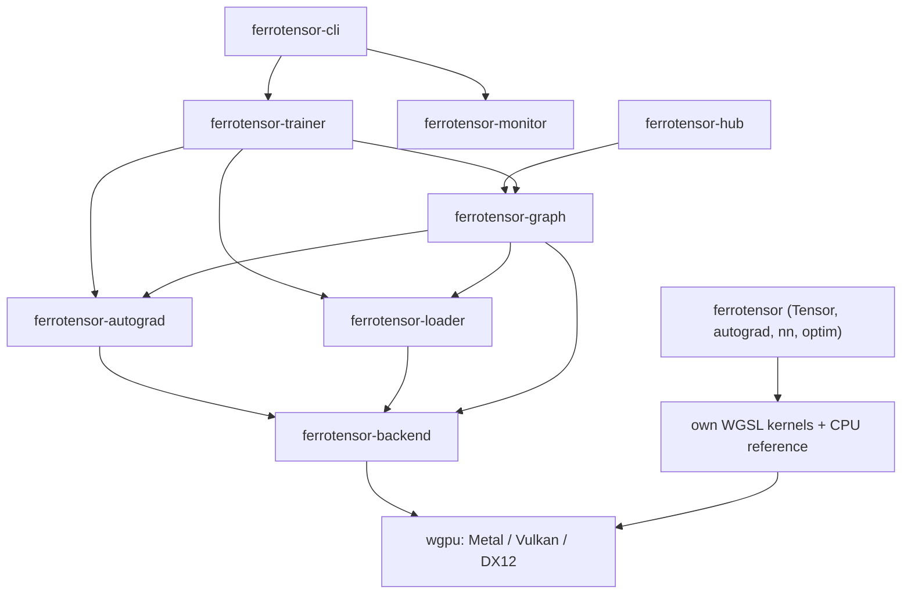

<h1 align="center">Ferrotensor</h1>

<p align="center"><strong>A pure-Rust GPU ML framework: no CUDA, no Python, no C++ toolchain.</strong></p>

<p align="center">
  <a href="https://github.com/puranikyashaswin/ferrotensor/actions/workflows/ci.yml"></a>
  <a href="https://crates.io/crates/ferrotensor"></a>
  <a href="https://docs.rs/ferrotensor"></a>
  
  
  
  
</p>

Ferrotensor (Ferro Tensor) runs tensors, autograd and LoRA fine-tuning of
small language models on the GPU using [wgpu](https://wgpu.rs) and
hand-written WGSL compute kernels, which run through Vulkan, Metal or DX12.
It has been tested on an NVIDIA A10G (24 GB) through Vulkan, an Apple M2
(8 GB) through Metal, and software Vulkan (Mesa lavapipe) in CI; other GPUs
are untested, and [reports are welcome](docs/testing-on-your-gpu.md). There
is no CUDA, cuDNN or libtorch to install and no Python at runtime:
`cargo build` is the whole toolchain. The same tensor API also runs on a CPU
device, which the test suite uses as the reference for the GPU. It is built
for anyone who wants to read, and change, every layer from the API down to
the shader. It is young: pre-1.0, one maintainer, small-scale by design.
Arithmetic and trainable parameters are f32; the CLI stores frozen LoRA base
weights as f16 by default to save memory (`--f32-weights` keeps them f32).

- [Install](#install) · [Quickstart](#quickstart) · [Python](#python) · [Features](#feature-matrix) · [Architecture](#architecture) · [Compared with candle, burn and tch](#compared-with-candle-burn-and-tch) · [Roadmap](#roadmap)
<!-- Switch the how-to guide link back to https://ferrotensor.dev/guide/ once the domain's DNS points at GitHub Pages. -->
- Docs: [how-to guide](https://puranikyashaswin.github.io/ferrotensor/guide/) · [architecture](docs/architecture.md) · [writing a kernel](docs/writing-a-kernel.md) · [use cases](docs/use-cases.md) · [LoRA SFT walkthrough](docs/examples/lora-sft.md) · [adapters in PyTorch (PEFT)](docs/examples/peft-export.md) · [benchmarks](benchmarks/RESULTS.md) · [testing on your GPU](docs/testing-on-your-gpu.md) · [Mac benchmark harness](docs/benchmarks-mac.md) · [API docs](https://docs.rs/ferrotensor)


## Highlights

Every GPU number here is from one NVIDIA A10G (24 GB) through Vulkan. The
LoRA recipe is the one in the [walkthrough](docs/examples/lora-sft.md):
SmolLM2, cleaned Alpaca, LoRA rank 8 on q/k/v/o, sequence length 256, 8
sequences per optimizer step.

- **Loss and gradients checked against PyTorch autograd, in CI.**
  [`ferrotensor-trainer/tests/gradient_parity.rs`](ferrotensor-trainer/tests/gradient_parity.rs)
  runs a tiny Llama-style model (2 layers, hidden 32) with LoRA on every
  linear layer on the GPU and compares the loss, the logits and every
  trainable gradient (30 or 50 tensors per case; one sequence, a batch, a
  loss mask, trainable base weights) with fixtures from PyTorch autograd
  ([`scripts/gen_gradient_fixtures.py`](scripts/gen_gradient_fixtures.py)).
  Every element must be within 1e-4 + 1e-3 × |expected|; the largest
  gradient difference on the A10G was 9.5e-7. It runs on every pull request
  on software Vulkan. The model is tiny, so it does not catch effects that
  only appear at scale.
- **Held-out loss against PyTorch + PEFT on CUDA.** Same GPU, same recipe,
  one seed per run: the held-out loss before training is identical to four
  decimals, and after 250 steps Ferrotensor is within 0.005 of PyTorch for
  SmolLM2-135M and SmolLM2-1.7B. Ferrotensor is slower per step: 0.84× of
  PyTorch's speed for 135M at batch 1, 0.32× at batch 8, and 0.37× for 1.7B,
  and PyTorch used less GPU memory in every configuration. This comparison
  was measured on a 0.6 development build with f32 base weights, before the
  memory work below
  ([comparison](docs/examples/lora-sft.md#against-pytorch--peft-on-cuda-same-gpu)).
- **Less GPU memory for LoRA, with the same losses.** Peak GPU memory
  (`nvidia-smi`, MiB) for 30 optimizer steps with f16 base weights, batch 1
  × 8-step accumulation unless noted:

  | Model | 0.6 | 0.7 default | 0.7 `--checkpoint-blocks` | Time per step with `--checkpoint-blocks` |
  |---|---:|---:|---:|---:|
  | SmolLM2-135M | 3,451 | 2,362 | 1,890 | +26% |
  | SmolLM2-360M | 5,411 | 3,595 | 2,719 | +31% |
  | SmolLM2-1.7B | 11,607 | 8,222 | 5,245 | +39% |
  | SmolLM2-135M, batch 8 | 15,758 | 9,401 | 2,879 | +19% |

  <!-- Maintainer: the 0.6 column is the stage-0 baseline measured at 364490b with this setup. The walkthrough's 0.6 table (250 steps at b319ce7) has 12,199 MiB for SmolLM2-1.7B with f16 weights; the 592 MiB difference is not explained yet, so only one baseline is shown here. -->

  Losses are identical at every stage: the training loss and gradient norm
  as printed at all 30 steps, and the held-out loss after them. The 0.7
  default releases each intermediate gradient once it is used and reuses
  freed buffers; `--checkpoint-blocks` recomputes each decoder block's
  forward pass during backward instead of keeping its activations. The same
  setting measured in separate sessions differed by up to 192 MiB.
  `train --memory-report` prints where the memory goes
  ([CLI docs](ferrotensor-cli/README.md#where-gpu-memory-goes---memory-report)).
- **Adapters for PyTorch.** `ferrotensor export-adapter` writes a standard
  PEFT adapter; CI loads it in PyTorch + PEFT and checks that the logits
  match Ferrotensor's within 1e-3 ([how](docs/examples/peft-export.md)).

On an Apple M2 (8 GB) through Metal, a 0.4 build fine-tuned SmolLM2-135M with
the same recipe to the same held-out loss as the A10G with that build (2.4250
→ 1.6519). There are no current speed or memory numbers for the Mac.

## Install

You need Rust 1.88+ (`rustup` is enough). On macOS no other setup is needed.

```bash
cargo add ferrotensor           # the tensor API, in your project
cargo install ferrotensor-cli   # the `ferrotensor` command: LoRA train / eval / generate
pip install ferrotensor         # Python bindings (macOS arm64 and Linux x86_64 wheels)
```

To check your GPU in one command, `ferrotensor info --check` lists the adapters
wgpu can see and runs the matmul, softmax and RMSNorm kernels against a CPU
reference ([details](docs/testing-on-your-gpu.md)).

## Quickstart

From a checkout:

```bash
git clone https://github.com/puranikyashaswin/ferrotensor.git
cd ferrotensor
cargo run --release -p ferrotensor --example quickstart
```

Output on an Apple M2 (the device line changes with your hardware):

```
device: Apple M2 (Metal)
x @ w = [7.5, 2.0, 18.0, 2.0] (shape [2, 2])
dL/dw = [5.0, 5.0, 7.0, 7.0, 9.0, 9.0]
```

That is [`ferrotensor/examples/quickstart.rs`](ferrotensor/examples/quickstart.rs): a
matmul and its gradient on the best available device. No GPU? Use
`Device::cpu()`; the same code runs.

In your own code:

```rust
use ferrotensor::prelude::*;

let device = Device::cpu(); // or Device::best() for a GPU when present
let model = nn::Sequential::new(&device)
    .add(nn::Linear::new(2, 16, &device))
    .add(nn::Tanh)
    .add(nn::Linear::new(16, 2, &device));
let mut opt = optim::AdamW::new(model.parameters(), 0.05).weight_decay(0.0);

// XOR
let x = Tensor::from_data(&[0., 0., 0., 1., 1., 0., 1., 1.], &[4, 2], &device);
let y = Tensor::from_data(&[0., 1., 1., 0.], &[4], &device);
for _ in 0..200 {
    opt.zero_grad();
    let loss = F::cross_entropy(&model.forward(&x), &y);
    loss.backward();
    opt.step();
}
```

More runnable programs, with their real output, are in
[docs/use-cases.md](docs/use-cases.md): an MLP with a `DataLoader`, a
character-level transformer trained from scratch, a CPU-vs-GPU matmul and
attention comparison, and similarity search.

## Python

The `ferrotensor-py` crate binds the tensor API to Python (PyTorch-style
tensors, autograd, `nn`, `optim`, safetensors; CPU or GPU). No NumPy needed.

```bash
pip install ferrotensor
# or, from a checkout of this repository:
pip install ./ferrotensor-py
```

```python
import ferrotensor as ft
from ferrotensor import nn, optim
import ferrotensor.nn.functional as F

model = nn.Sequential(nn.Linear(2, 16), nn.Tanh(), nn.Linear(16, 2))
opt = optim.AdamW(model.parameters(), lr=0.05, weight_decay=0.0)
x = ft.tensor([[0, 0], [0, 1], [1, 0], [1, 1]])
for _ in range(200):
    opt.zero_grad()
    loss = F.cross_entropy(model(x), [0, 1, 1, 0])  # XOR
    loss.backward()
    opt.step()
print(model(x).argmax(dim=1).tolist())  # [0.0, 1.0, 1.0, 0.0]
```

Devices, the full list of what is covered, and the differences from PyTorch
are in [ferrotensor-py/README.md](ferrotensor-py/README.md).

## Feature matrix

"Stable" means implemented, covered by tests, and used by the examples; the
API can still change before 1.0. "Experimental" means it runs but is less
tested, incomplete, or only checked on one machine.

| Area | Status | Notes |
|------|--------|-------|
| `Tensor` on GPU (wgpu) and CPU | **Stable** | `f32`; broadcasting element-wise ops, reductions, batched matmul, softmax, permute, slice/cat, gathers. Whole-tensor reductions and `argmax`/`argmin` run fully on the GPU |
| Autograd | **Stable** | Reverse mode; op gradients are checked against finite differences on the CPU, and GPU gradients against the CPU. The LoRA training path is also checked against PyTorch autograd (`ferrotensor-trainer/tests/gradient_parity.rs`) |
| `nn` layers | **Stable** | `Linear`, `Embedding`, `LayerNorm`, `RMSNorm`, `Dropout`, causal `MultiHeadAttention` with a KV cache, activations, `Sequential` |
| Optimizers and LR schedules | **Stable** | `SGD` (momentum, Nesterov), `AdamW`, gradient clipping, constant/step/cosine/warmup schedules |
| Safetensors save/load, state dicts | **Stable** | `ferrotensor::serialize` |
| `DataLoader` | **Stable** | Batching, seeded shuffling, optional prefetching on a background thread (`epoch_prefetched`) |
| Reproducible randomness | **Stable** | `manual_seed` (Rust and Python) seeds random tensors, layer initialisation and dropout |
| LoRA fine-tuning of Llama-style models (`ferrotensor-cli`) | **Experimental** | Measured with SmolLM2-135M, 360M and 1.7B on an NVIDIA A10G (24 GB), and SmolLM2-135M on an Apple M2 (8 GB) with a 0.4 build; see the [LoRA walkthrough](docs/examples/lora-sft.md). Larger models are untested |
| Llama / LFM2-style blocks (`ferrotensor-graph`) | **Experimental** | Attention with RoPE, SwiGLU MLP, RMSNorm, KV cache. Qwen3-style per-head q/k norms are implemented and checked on a small synthetic model against a CPU reference; real Qwen3 checkpoints are not measured yet |
| Flash attention kernels (`ferrotensor-backend`) | **Experimental** | Forward v2 and a backward kernel; see the `flash_attention_*` cases in `ferrotensor-autograd/tests/grad_check.rs` |
| Checkpoint/resume (`ferrotensor-trainer`) | **Experimental** | |
| Loss scaler (`GradScaler` in `ferrotensor-trainer`) | **Experimental** | A library type: `Trainer::with_grad_scaler` attaches it, the CLI does not use it, and `ferrotensor demo` only constructs one. Gradients are f32, so there is no f16 underflow for it to guard against |
| Mixed-precision (f16 activations and gradients) training | Planned | Today only frozen LoRA base weights are stored below f32 (f16 by default; 4-bit with `--q4-weights`, experimental, [changes the results](ferrotensor-cli/README.md#frozen-base-weights-f16-f32-or-4-bit-experimental)); arithmetic, activations, gradients and adapters are f32 |
| Terminal monitor, Hub download helpers | **Experimental** | `ferrotensor-monitor`, `ferrotensor-hub` |
| `f16` / `bf16` tensors in the `ferrotensor` API | Planned | |
| Convolutions, sort/top-k, cumsum in the `ferrotensor` API | Planned | |
| Batched GPU dispatch in the `ferrotensor` API | **Stable** | Ops submit together at each read back; `char_transformer` trains faster on the GPU than the CPU, but chains of tiny ops are still faster on the CPU ([numbers](benchmarks/RESULTS.md#ferrotensor-tensor-api-cpu-and-gpu-devices)) |
| Python bindings (`ferrotensor-py`) | **Experimental** | Tensors, autograd, `nn`, `optim`, safetensors; wheels for macOS arm64 and Linux x86_64 on PyPI |
| GPU report and kernel self-check (`ferrotensor info`) | **Experimental** | Lists adapters and checks matmul, softmax and RMSNorm against the CPU; passes on an Apple M2 (Metal), an NVIDIA A10G and a Tesla T4 (Vulkan; the T4 at the commit in [benchmarks/RESULTS.md](benchmarks/RESULTS.md#nvidia-gpus-through-vulkan)), and software Vulkan in CI. AMD and Intel GPUs, and DX12, are untested ([help test it](docs/testing-on-your-gpu.md)) |
| Op fusion in the `ferrotensor` API | **Experimental** | Off by default; `FERROTENSOR_FUSION=1` runs chains of same-size element-wise ops as one dispatch, bit-identical to unfused ([design](docs/design/op-fusion.md)) |
| Multi-GPU / distributed training | Planned | `ferrotensor-cli` has a file-based gradient sync flag (`--world-size`) that is a prototype |
| A CUDA backend | Not planned | wgpu is the point of the project |

## Architecture



The workspace has two layers. The **`ferrotensor`** crate is the PyTorch-style tensor
API (it carries its own small set of generic kernels and a CPU device). The
**LLM stack** (`ferrotensor-backend` through `ferrotensor-cli`) has purpose-built kernels
for Llama-style models and the LoRA fine-tuning CLI. Details, including how a
tensor op reaches a WGSL kernel, are in [docs/architecture.md](docs/architecture.md).

| Crate | What it is |
|-------|------------|
| [`ferrotensor`](ferrotensor) | Tensor, autograd, `nn`, `optim`, `serialize`, `data` |
| [`ferrotensor-backend`](ferrotensor-backend) | wgpu context, WGSL kernels (matmul, RoPE, RMSNorm, flash attention, AdamW, ...), buffer pool |
| [`ferrotensor-autograd`](ferrotensor-autograd) | Gradient tape for the backend tensors |
| [`ferrotensor-graph`](ferrotensor-graph) | Transformer building blocks and the Llama/LFM2-style model builder |
| [`ferrotensor-loader`](ferrotensor-loader) | Safetensors (single and sharded) and tokenizer loading |
| [`ferrotensor-trainer`](ferrotensor-trainer) | Training loops, LoRA, checkpoints, an optional `GradScaler` |
| [`ferrotensor-cli`](ferrotensor-cli) | The `ferrotensor` command: `train`, `eval`, `generate` (alias `infer`), `export-adapter`, `info`, `classify-train`, `classify-predict`, `monitor`, `demo` |
| [`ferrotensor-monitor`](ferrotensor-monitor) | Terminal dashboard |
| [`ferrotensor-hub`](ferrotensor-hub) | Hugging Face Hub download helpers |
| [`ferrotensor-py`](ferrotensor-py) | Python bindings for the `ferrotensor` crate (not published to crates.io) |
| [`benchmarks`](benchmarks) | GPU kernel and tensor-API benchmarks |

## Fine-tuning a model

`ferrotensor-cli` fine-tunes small Llama-style models with LoRA (response-only loss
and a chat template for SFT) and can run short pretraining on `.txt` or packed
`.bin` token files:

```bash
cargo run -p ferrotensor-cli --release -- train \
  --lite --task sft \
  --model ./models/tinyllama \
  --data ./data/train.jsonl \
  --out ./outputs/run1
```

`--help` lists every flag. A step-by-step walkthrough with real output is in
[docs/examples/lora-sft.md](docs/examples/lora-sft.md).
This path is experimental.

## Compared with candle, burn and tch

These are good projects; Ferrotensor is not trying to replace them. The honest
picture, as of this writing:

| | Ferrotensor | [candle](https://github.com/huggingface/candle) | [burn](https://github.com/tracel-ai/burn) | [tch-rs](https://github.com/LaurentMazare/tch-rs) |
|---|---|---|---|---|
| What it is | Small pure-Rust framework on wgpu | Minimalist Rust ML framework from Hugging Face | Full Rust deep-learning framework with swappable backends | Rust bindings to libtorch (PyTorch's C++ library) |
| GPU story | wgpu only: Metal, Vulkan, DX12 | CUDA and Metal, plus CPU | wgpu, CUDA, Metal, CPU and others through backends | Whatever libtorch supports, notably CUDA |
| Needs a C++/CUDA toolchain | No | For CUDA builds | Depends on backend | Yes, libtorch |
| Maturity | Young, pre-1.0, one maintainer | Widely used, many reference model implementations | Widely used, training-focused, large API | Mature, full PyTorch op coverage |
| Model zoo / ecosystem | Tiny | Large | Growing | The whole PyTorch ecosystem via TorchScript/weights |

Choose candle for inference of popular models, burn for a mature all-Rust
training framework, tch-rs when you need exact PyTorch semantics and CUDA.
Choose Ferrotensor to learn how the stack works end to end, when you want a
dependency-light wgpu-only codebase you can read and modify, or to
experiment on a consumer GPU without installing CUDA. Ferrotensor does not match
their op coverage, model support or hardening, and we have not benchmarked it
against them; kernel-level numbers for Ferrotensor alone are in
[benchmarks/RESULTS.md](benchmarks/RESULTS.md).

## Roadmap

- [x] Rebuilt tensor core with a CPU device, checked autograd, differentiable `nn` layers, LR schedules, safetensors state dicts
- [x] CI: fmt, clippy, tests on Linux and macOS, docs, MSRV, cargo-deny
- [x] Reliable end-to-end LoRA SFT run, documented ([walkthrough](docs/examples/lora-sft.md))
- [x] Published kernel benchmarks ([benchmarks/RESULTS.md](benchmarks/RESULTS.md))
- [x] First crates.io release (0.1.0)
- [x] Batched GPU dispatch for many small ops ([before/after numbers](benchmarks/RESULTS.md#ferrotensor-tensor-api-cpu-and-gpu-devices))
- [x] Python bindings (`ferrotensor-py`)
- [x] Python wheels on PyPI
- [x] Fuse element-wise op chains into one kernel (opt-in with `FERROTENSOR_FUSION=1`)
- [x] Tested on NVIDIA GPUs through Vulkan, and the GPU suites run in CI on software Vulkan ([results](benchmarks/RESULTS.md))
- [x] LoRA measured up to SmolLM2-1.7B, with the backward passes and the loss on the GPU ([walkthrough](docs/examples/lora-sft.md#on-an-nvidia-gpu-three-model-sizes))
- [ ] Op fusion on by default (needs a measurement on more GPUs)
- [x] Lower host memory when loading models (SmolLM2-1.7B peaks at 5.3 GB of host memory)
- [x] Batched LoRA training and f16 base weights ([measured](docs/examples/lora-sft.md#batching-f16-base-weights-and-lower-host-memory-06))
- [x] Gradient parity with PyTorch autograd in CI, PEFT adapter export
- [x] Lower GPU memory for LoRA: gradients released early, freed buffers reused, `--checkpoint-blocks`
- [ ] Results from AMD and Intel GPUs, and from DX12
- [ ] Parallel-reduction softmax and layer norm kernels
- [ ] `f16`/`bf16` tensors in the `ferrotensor` API, convolutions, sort/top-k
- [ ] Unify the `ferrotensor` tensor API with the LLM stack

## Contributing

Contributions are welcome. [CONTRIBUTING.md](CONTRIBUTING.md) covers setup,
tests and the PR process; [docs/good-first-issues.md](docs/good-first-issues.md)
lists concrete starting points; [docs/writing-a-kernel.md](docs/writing-a-kernel.md)
walks through adding a GPU op.

## License

Licensed under either of

- Apache License, Version 2.0 ([LICENSE-APACHE](LICENSE-APACHE))
- MIT license ([LICENSE-MIT](LICENSE-MIT))

at your option. Unless you explicitly state otherwise, any contribution
intentionally submitted for inclusion in the work by you, as defined in the
Apache-2.0 license, shall be dual licensed as above, without any additional
terms or conditions.

## Acknowledgments

[wgpu](https://github.com/gfx-rs/wgpu) for the cross-platform GPU layer,
[safetensors](https://github.com/huggingface/safetensors) for the weight
format, and [FlashAttention](https://arxiv.org/abs/2205.14135) for the
attention algorithm.
