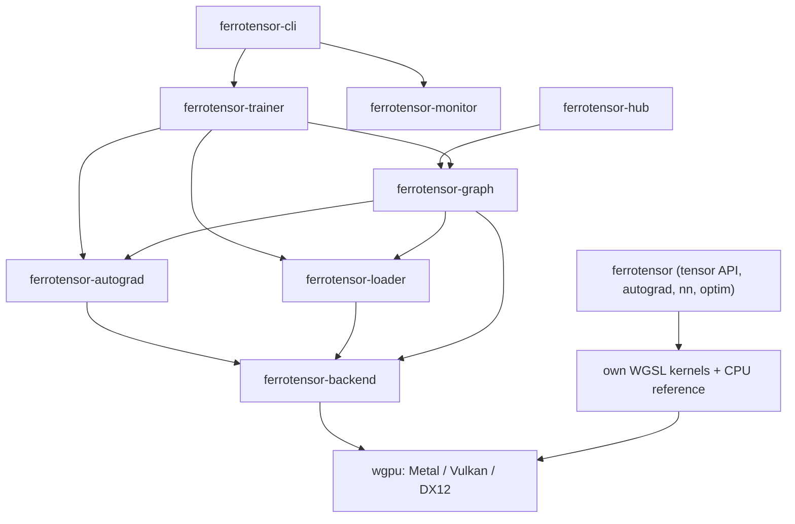

# Architecture

This page follows one tensor op, `a.matmul(&b)`, from the Rust API to a WGSL
kernel and back, explains how GPU ops are batched, and shows how the crates
and the Python package fit together. File references
are to the `ferrotensor` crate unless noted.

## Two stacks in one workspace

The workspace holds two layers of code that do not depend on each other at the
source level:

| Stack | Crates | What it is |
|-------|--------|------------|
| **Tensor API** | `ferrotensor` (and `ferrotensor-py`, its Python binding) | A PyTorch-style `Tensor` with autograd, `nn`, `optim`, `serialize` and a CPU device. Has its own small set of generic WGSL kernels (`ferrotensor/src/backend/kernels.rs`). |
| **LLM fine-tuning stack** | `ferrotensor-backend`, `ferrotensor-autograd`, `ferrotensor-graph`, `ferrotensor-loader`, `ferrotensor-trainer`, `ferrotensor-cli`, `ferrotensor-monitor`, `ferrotensor-hub` | Hand-written kernels for Llama/LFM2-style models (RoPE, RMSNorm, flash attention, AdamW, int8 dequantisation), LoRA, safetensors loading, the training CLI. |

`ferrotensor/Cargo.toml` lists the LLM crates as dependencies, but `ferrotensor/src` does
not call into them today (see [good-first-issues](good-first-issues.md)). The
rest of this page is about the `ferrotensor` tensor API; the LLM stack is described
in each crate's README.



## Following `a.matmul(&b)`

### 1. The public op (`tensor/ops.rs`)

`Tensor::matmul` is a thin wrapper. It calls the *raw* kernel, then attaches a
backward closure:

```rust
pub fn matmul(&self, other: &Tensor) -> Tensor {
    let out = self.matmul_raw(other);          // forward, no autograd
    let (a, b) = (self.detach(), other.detach());
    let need = (self.requires_grad, other.requires_grad);
    out.with_node("matmul", vec![self.clone(), other.clone()], move |g| {
        vec![
            need.0.then(|| sum_to_shape(&g.matmul_raw(&b.transpose()), &a.shape)),
            need.1.then(|| sum_to_shape(&a.transpose().matmul_raw(g), &b.shape)),
        ]
    })
}
```

`with_node` only records the node when gradient tracking is on and an input
requires grad (`tensor/autograd.rs`). Everything inside `no_grad(|| ...)`
skips it.

### 2. Device dispatch (`tensor/raw.rs`)

Every `*_raw` method checks where the tensor lives:

```rust
match self.gpu() {
    Some((ctx, buffer)) => { /* build uniform + dispatch WGSL kernel */ }
    None                => { /* run the reference kernel in tensor/cpu.rs */ }
}
```

A `Tensor` holds `Arc<Storage>`, where `Storage` is either
`Cpu(RwLock<Vec<f32>>)` or `Gpu(wgpu::Buffer)` (`tensor/core.rs`). Clones share
storage and the gradient slot, so a parameter held by a layer and by an
optimizer is the same variable.

On the GPU path the method:

1. allocates the output buffer (`alloc`), reusing a freed buffer of the same
   size from the device's pool when there is one,
2. describes each binding as an `Arg` (a whole storage buffer, a 16-byte
   `Params` uniform, or a `Meta` array of shape and stride words),
3. calls `ctx.dispatch("matmul", &[Arg::Buffer(a), Arg::Buffer(b), Arg::Buffer(&out), params, ...], workgroups)`.

`dispatch` does not run anything: it *records* the op (see
[Batched GPU dispatch](#batched-gpu-dispatch)).

### 3. The compute engine (`backend/compute.rs`)

`ComputeEngine::new` compiles one WGSL module (`KERNELS_WGSL`, defined in
`backend/kernels.rs`) and builds one compute pipeline per entry point in
`KERNEL_NAMES`: `unary`, `binary`, `reduce`, `softmax`, `matmul`, `permute`,
`gather_rows`. `ComputeEngine::dispatch` builds a bind group that binds
`resources[i]` to `@binding(i)` of group 0 and returns a `Dispatch` (kernel,
bind group, grid); `ComputeEngine::encode` writes a list of them into one
compute pass. `workgroups_1d` and `workgroups_matmul` compute the grid.

The kernels are *generic*: `unary` takes an op code in a uniform and switches
on it, so most element-wise ops share one pipeline. That is why adding such an
op is a handful of lines (see [writing-a-kernel.md](writing-a-kernel.md)).

### 4. The WGSL kernel (`backend/kernels.rs`)

`matmul` is a 16x16 tiled kernel: each workgroup loads tiles of `A` and `B`
into workgroup memory, synchronises with `workgroupBarrier()`, and accumulates
one output element per thread. The batch index comes from the z dimension of
the grid.

### 5. Reading the result back

Nothing waits for the GPU until you ask for data. `Tensor::to_vec()` (and
`item()`) submit every op recorded so far, copy the buffer into a staging
buffer and wait for it to map. Chains of ops stay on the device; a `to_vec()`
is the synchronisation point. This is also why timing code must read a value
back or call `Device::synchronize()` (see `examples/gpu_matmul_attention.rs`).

## Batched GPU dispatch

A GPU op used to be one queue submission each, which cost about as much as a
small kernel does. Now each GPU `Device` owns a `GpuContext` (`device.rs`)
holding a list of *pending* work, and ops are recorded into it:

1. `GpuContext::dispatch` appends the op's uniforms and shape metadata to one
   shared staging area (`Pending::args`, 256 KiB of argument buffer per
   device), creates the bind group over a slice of the argument buffer, and
   pushes a `Dispatch` onto the pending list. Buffer-to-buffer copies are
   recorded the same way.
2. At a sync point the whole batch goes out at once: the arguments are written
   to the argument buffer with one `write_buffer`, the pending dispatches are
   encoded into **one compute pass** of one command encoder, and that is
   submitted once. The sync points are:
   - a read back (`to_vec`, `item`, anything built on them),
   - a host write into a GPU buffer (`write_buffer` flushes first, because the
     queue applies writes before the next submission's commands),
   - `Device::synchronize()`, which also waits for the GPU to finish,
   - the 256th pending op (`MAX_PENDING_OPS`), so memory use stays bounded.
3. The queue runs the batch in recording order, and wgpu orders the storage
   reads and writes of consecutive dispatches in a pass, so every op sees the
   results of the ones before it. Results are bit-identical to submitting each
   op alone.

Three supporting pieces:

- **Buffer pool.** Tensor buffers go back to a per-device pool when the last
  `Tensor` clone drops (up to 128 MiB), and `alloc` reuses one of the same
  size. This also skips wgpu's zero fill of new buffers.
- **Bind group layouts** are taken once from each pipeline at start-up, not
  per op.
- **Spin-wait on read back.** `wait_for` busy-polls the device for up to
  10 ms before blocking, because wgpu 0.19's blocking wait on Metal sleeps in
  1 ms steps.

Things to know when writing an op:

- Do not call `queue.submit` or read a buffer yourself: go through
  `ctx.dispatch` / `ctx.copy`, or the ordering guarantee is lost.
- An op that reads values back to the host in the middle of its work (for
  example `cross_entropy` with class-index targets, `argmax`/`argmin`, `cat`,
  and the backward passes of `index_select` and `Embedding`) forces a sync and
  splits the batch. Prefer a kernel that stays on the device.
- Each dispatch in a pass still costs the GPU roughly 9-13 µs on an M2, so a
  chain of 100 tiny element-wise ops is about 18x slower than on the CPU even
  though it is 13x faster than before batching. Fusing such chains into one
  kernel is the next step.

Before/after numbers and the method are in
[benchmarks/RESULTS.md](../benchmarks/RESULTS.md#ferrotensor-tensor-api-cpu-and-gpu-devices);
`cargo run -p ferrotensor-benchmarks --release --bin tensor-api` reproduces
them.

## The backward pass

`loss.backward()` (`tensor/autograd.rs`) sorts the recorded graph
topologically and walks it in reverse, calling each node's closure with the
incoming gradient and summing gradients that reach the same input. The
closures are written with ordinary tensor ops, run with tracking disabled, so
the backward pass runs on the same device as the forward pass: GPU kernels for
a GPU tensor, the CPU reference for a CPU tensor.

## Why there is a CPU device

`Device::cpu()` runs the same ops through `tensor/cpu.rs`. It exists for three
reasons:

- **Correctness oracle.** The test suite checks every op's gradient against
  central finite differences on the CPU (`tensor/tests.rs`), then, with
  `FERROTENSOR_RUN_GPU_TESTS=1`, checks that the GPU forward values and gradients
  match the CPU.
- **CI without a GPU.** GitHub runners have no GPU, so the default
  `cargo test` never touches wgpu.
- **Small models.** For tiny workloads the CPU is faster (see
  [use-cases.md](use-cases.md)).

## Layers above the tensor

- `nn` (`nn/`): the `Module` trait (`forward`, `parameters`,
  `named_parameters`) and layers: `Linear`, `Embedding`, `LayerNorm`,
  `RMSNorm`, `Dropout`, `MultiHeadAttention`, activations, `Sequential`.
  Layers are compositions of tensor ops, so they are differentiable for free.
- `optim` (`optim/`): `SGD`, `AdamW`, gradient clipping, LR schedulers. The
  updates are tensor ops run under `no_grad`, so they execute on the
  parameter's device.
- `serialize`: safetensors save/load and module state dicts keyed by
  `named_parameters`.
- `data`: `Dataset`, `TensorDataset`, `DataLoader` (batching, seeded shuffle).

## Python bindings

`ferrotensor-py` is a workspace crate (`publish = false`) that builds the
`ferrotensor._ferrotensor` extension module with
[pyo3](https://pyo3.rs) and ships it with
[maturin](https://www.maturin.rs) as an abi3 wheel for CPython 3.10 and newer.
It depends only on the public API of the `ferrotensor` crate.

- **Layers.** `src/*.rs` wraps `Device`, `Tensor`, the functional ops, the
  optimizers and `serialize` as Python classes and functions. The package
  in `ferrotensor-py/python/ferrotensor` is plain Python on top: `nn.Module`,
  `Sequential`, `ModuleList`, the LR-scheduler classes and `no_grad`.
- **Same tensors.** A Python `Tensor` holds a Rust `Tensor`, so autograd,
  devices and batched GPU dispatch behave exactly as described above: Python
  only issues ops, and the work is recorded and submitted at the next read
  back (`.item()`, `.tolist()`, printing).
- **Errors, not panics.** Arguments are checked in the bindings and raise
  `ValueError`, `IndexError` or `TypeError`. Every call into the crate also
  runs inside a `catch_unwind` guard (`src/error.rs`), so an assertion the
  checks missed arrives as a `RuntimeError` rather than aborting Python.
- **Versioning.** The package version is the workspace version, so the wheels
  published by `.github/workflows/python.yml` on a `v*` tag carry the same
  number as the Rust crates.

Usage and API coverage are in
[ferrotensor-py/README.md](../ferrotensor-py/README.md).

## The LLM stack in one paragraph

`ferrotensor-loader` reads safetensors and tokenizers into `ferrotensor-backend` buffers.
`ferrotensor-graph` builds a Llama/LFM2-style model from backend kernels (RMSNorm,
RoPE, flash attention, SwiGLU), with optional LoRA on the projections.
`ferrotensor-autograd` supplies the gradient tape and `ferrotensor-trainer` the loops
(SFT with response-only loss, pretraining, mixed-precision loss scaling,
checkpoint save/resume). `ferrotensor-cli` is the front end. This stack is
experimental; see the status table in the [README](../README.md).
